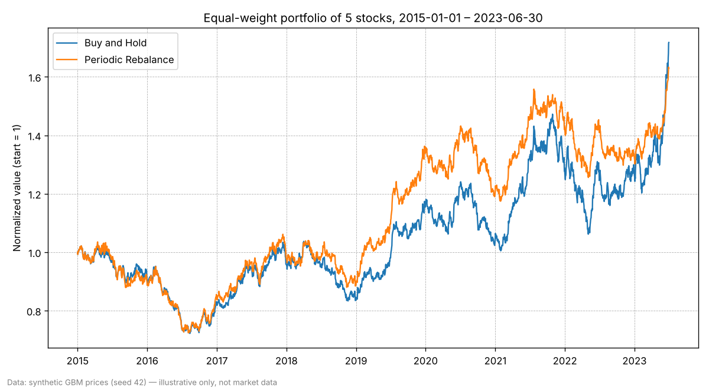

# Sample backtest result

- **Tickers:** SYN1, SYN2, SYN3, SYN4, SYN5
- **Period:** 2015-01-01 – 2023-06-30
- **Data:** synthetic GBM prices (seed 42) — illustrative only, not market data

| Metric | Buy and Hold | Periodic Rebalance |
| --- | ---: | ---: |
| Total return (%) | 71.75 | 62.95 |
| Annualized return (%) | 6.58 | 5.92 |
| Volatility, ann. (%) | 14.36 | 12.89 |
| Max drawdown (%) | -29.70 | -30.05 |
| Sharpe ratio (rf = 2%) | 0.32 | 0.30 |
| Monthly win rate (%) | 47.52 | 52.48 |

